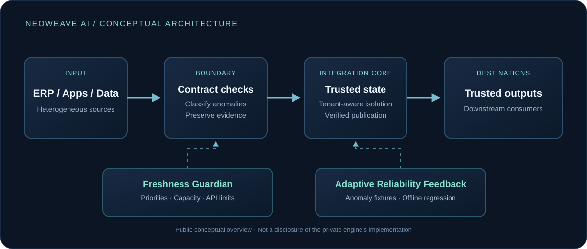

# NeoWeave AI

### Intelligent Enterprise Integration, Built for Reliability

**Connect complex systems. Protect trusted data. Keep critical information fresh.**

[Explore the project website](https://Khaled-NasrElDin.github.io/NeoWeave-AI-showcase/) · [Architecture overview](docs/architecture.svg) · [Technical overview](TECHNICAL_OVERVIEW.md)

---

## What is NeoWeave AI?

NeoWeave AI is an independently developed enterprise integration platform project focused on the difficult parts of connecting ERP systems, APIs, and business applications: **consistent data, operational resilience, multi-tenant isolation, and freshness-aware synchronization**.

Rather than treating integration as simple record transfer, the project explores how an integration engine can make reliable decisions when upstream systems are inconsistent, responses are ambiguous, networks fail, or APIs have limited capacity.

> **Project status:** Active development. The capabilities described here reflect project architecture and development work; they are not claims of production deployment or a verified ability to process millions of live ERP records. Scale to millions of records is a design goal.

## Core capabilities

| Capability | What it addresses |
| --- | --- |
| **Verified synchronization** | Avoids publishing partially trusted or inconsistent business data. |
| **Freshness Guardian** | Prioritizes synchronization work using freshness, workload pressure, and API constraints, targeting near-real-time updates where feasible. |
| **Adaptive Reliability Feedback Loop (ARFL)** | Captures integration anomalies and turns them into repeatable offline regression scenarios. Learning and validation are controlled rather than self-deploying code changes. |
| **Tenant-aware boundaries** | Designs for separation of customer data, source identities, and operational workloads. |
| **Recovery-oriented workflows** | Handles retries, uncertain remote outcomes, and evidence-driven recovery. |
| **Observability** | Makes incidents, synchronization status, and reliability signals visible for operators. |

## How the pieces fit together

The diagram is a **conceptual public overview**, not a representation of confidential implementation details.

## Real-time, with correctness first

NeoWeave AI targets **fresh, timely enterprise data**, but it does not treat *real-time* as an unconditional promise. Network behavior, ERP availability, rate limits, and source-side contracts impose practical limits. The Freshness Guardian focuses available capacity on the work that most needs attention while preserving correctness safeguards.

## Designed for scale

The long-term design goal is to support **millions of records across heterogeneous enterprise systems and multiple tenants**. Synthetic tests and benchmarks are part of development, but synthetic queue admission is not the same as proven end-to-end production throughput.

## What this repository contains

- A product-facing overview of NeoWeave AI
- A high-level, non-sensitive architecture diagram
- A static website suitable for GitHub Pages
- A transparent statement of development status and claim boundaries

**It does not contain the private integration engine**, including Python services, mapping logic, operational rules, configurations, tenant records, private tests, credentials, or proprietary source code.

## View the website

After GitHub Pages is enabled for this repository, the public product website will be available at:

**https://Khaled-NasrElDin.github.io/NeoWeave-AI-showcase/**

In GitHub: **Settings → Pages → Build and deployment → Deploy from a branch → `main` → `/docs` → Save**.

## Project and intellectual property

The product, screenshots, documentation, and architecture descriptions are presented for informational and portfolio purposes. **No license to reuse or redistribute the content is granted by this repository.** Lack of a license does not prevent others from viewing or downloading public files, and does not revoke applicable legal exceptions.

For professional inquiries, reach out through my [LinkedIn profile](https://www.linkedin.com/in/khaled-nasreldin/).

---

*NeoWeave AI is an evolving engineering project. Public descriptions are intentionally separated from private implementation details.*
